# Vymova

Pronunciation, grammar and vocabulary error analysis for students of Ukrainian, from a lesson recording.

<p align="center">
  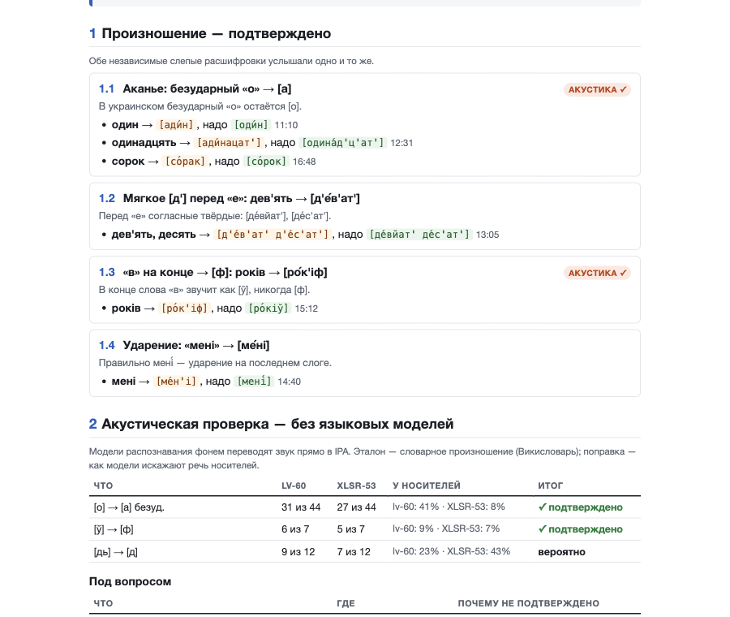
</p>

The tutor uploads a recording of an online group lesson and marks who is who. 15–20 minutes later they get
**one PDF for the whole lesson**. For each student it covers:
- which sounds they get wrong (confirmed by two independent checks);
- grammar mistakes;
- words from other languages;
- what to practise.

It also has a full phonetic transcript of every utterance, with links to the audio.

The app runs on the tutor's own computer. Recordings go only to the speech services the tutor holds keys for
(ElevenLabs and Google Gemini).

> The app's interface and reports are in Russian. They are written for the tutor and students.
> All screenshots below use a made-up demo lesson; the names and recordings are not real.

## What the tutor sees

| 1. Upload a lesson | 2. Mark who is who |
|---|---|
| 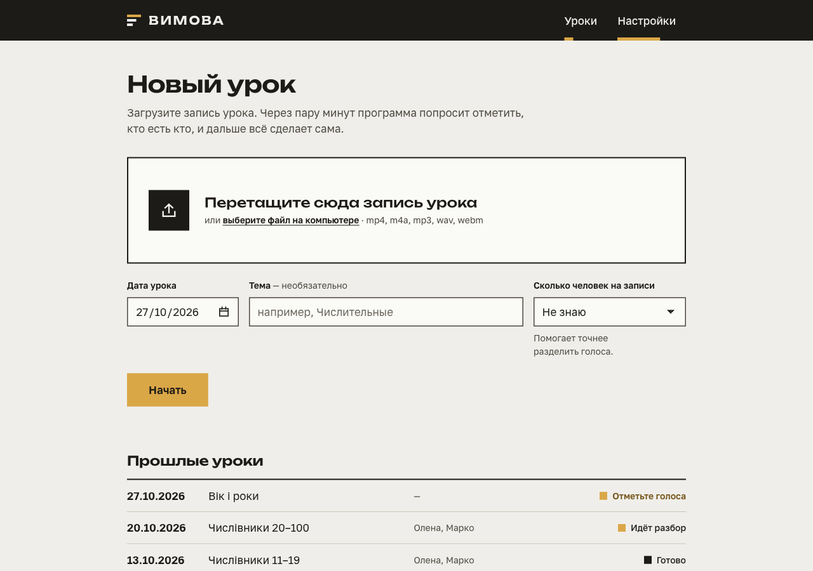 | 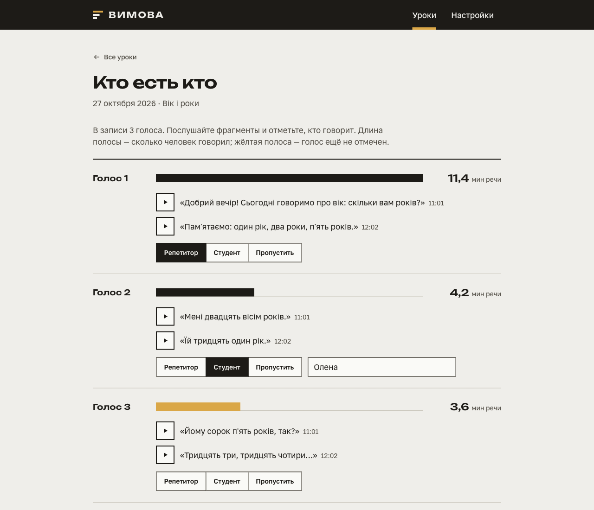 |
| Drag in the recording. Optionally add the date, topic and number of people. | Listen to two samples per voice and mark the tutor and each student. Names are remembered for next time. |
| **3. Processing** | **4. Done** |
| 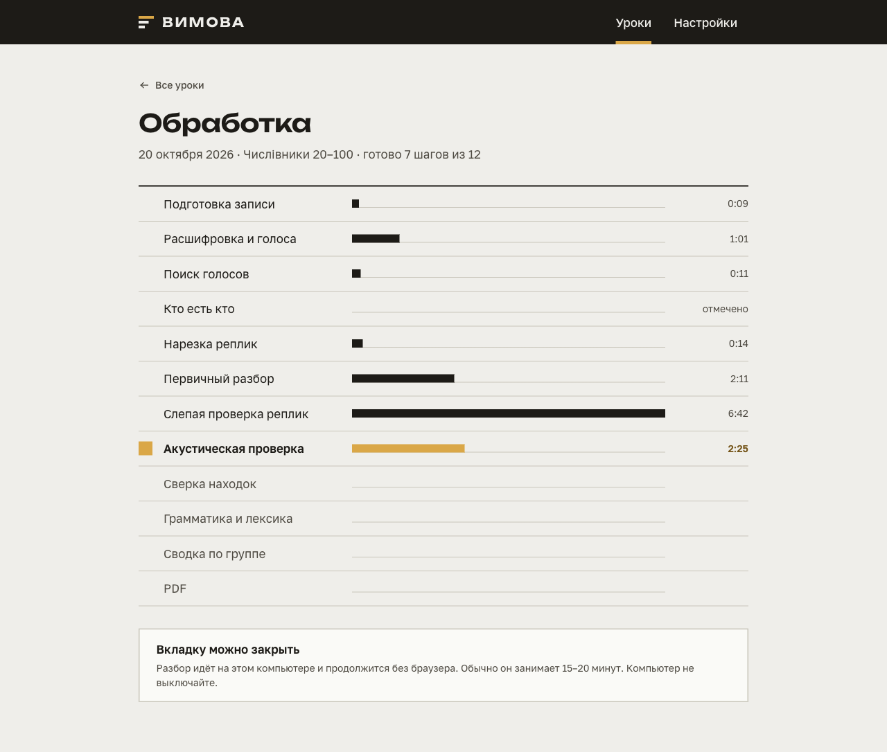 | 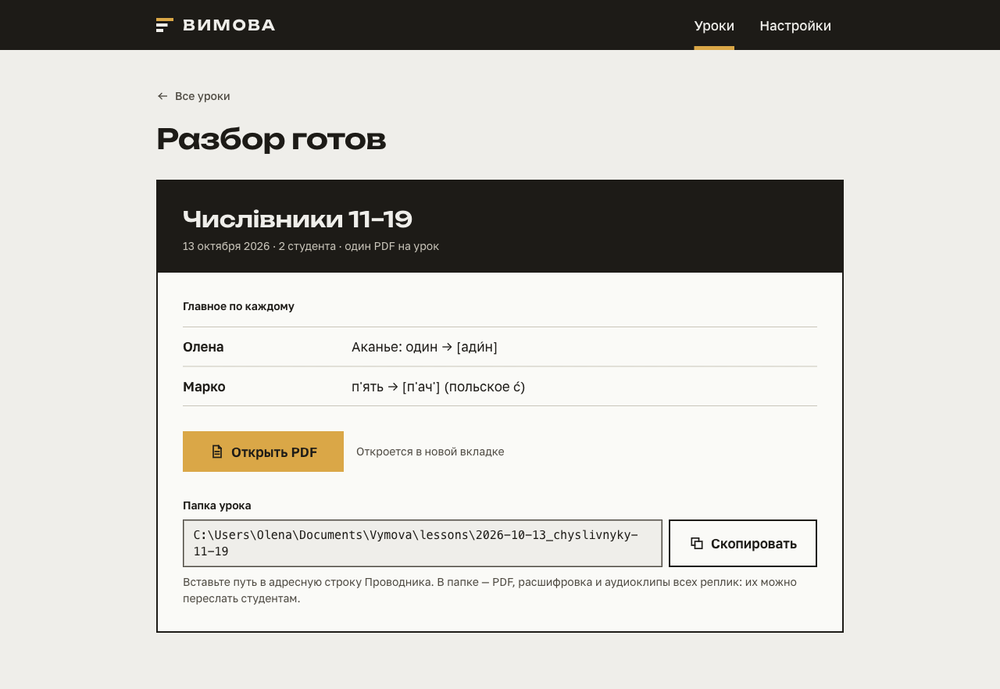 |
| Every step shows how long it took. The tab can be closed; processing continues. | The main point per student, the PDF, and the lesson folder (PDF, transcript, audio clips). |

<details>
<summary>Settings</summary>

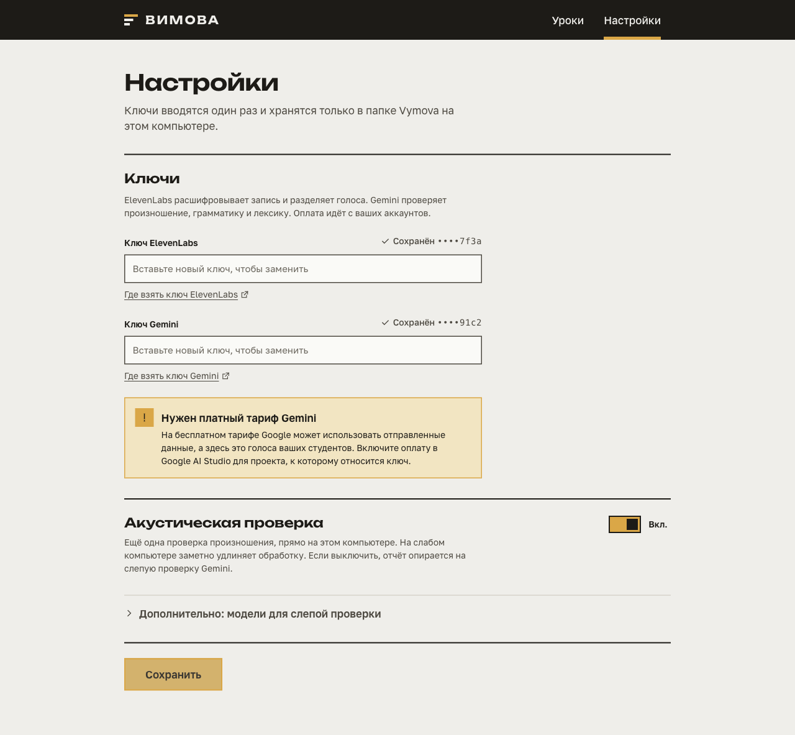

The keys are entered once and stored only in the app's folder on this computer.
</details>

## What the report contains

**Group summary and each student's top 5.** Shared mistakes are a ready topic for the next lesson.

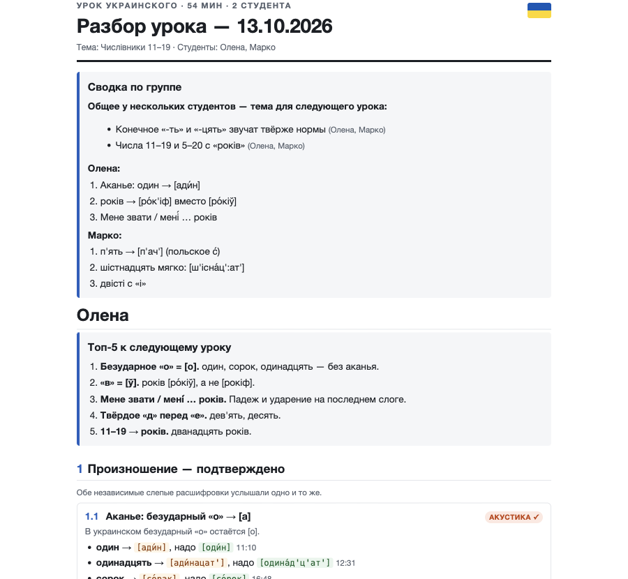

**Acoustic check without language models.** Phoneme recognisers turn the audio straight into IPA. The result is
compared with dictionary pronunciation and with how often the recognisers distort the same sound in native speech.

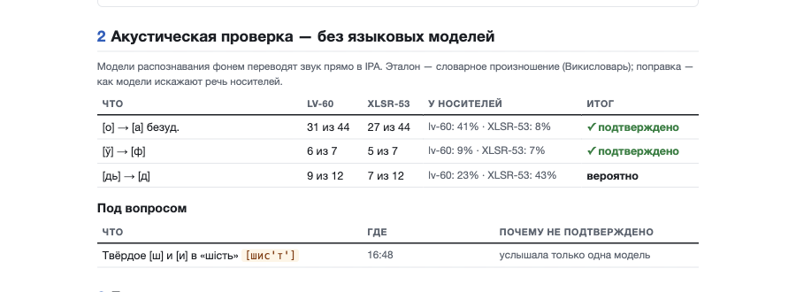

**Appendix: every utterance, phonetically.**
- Under each word: the IPA from both acoustic models.
- Below: both blind Gemini transcriptions.
- The clip number opens the audio of that utterance.

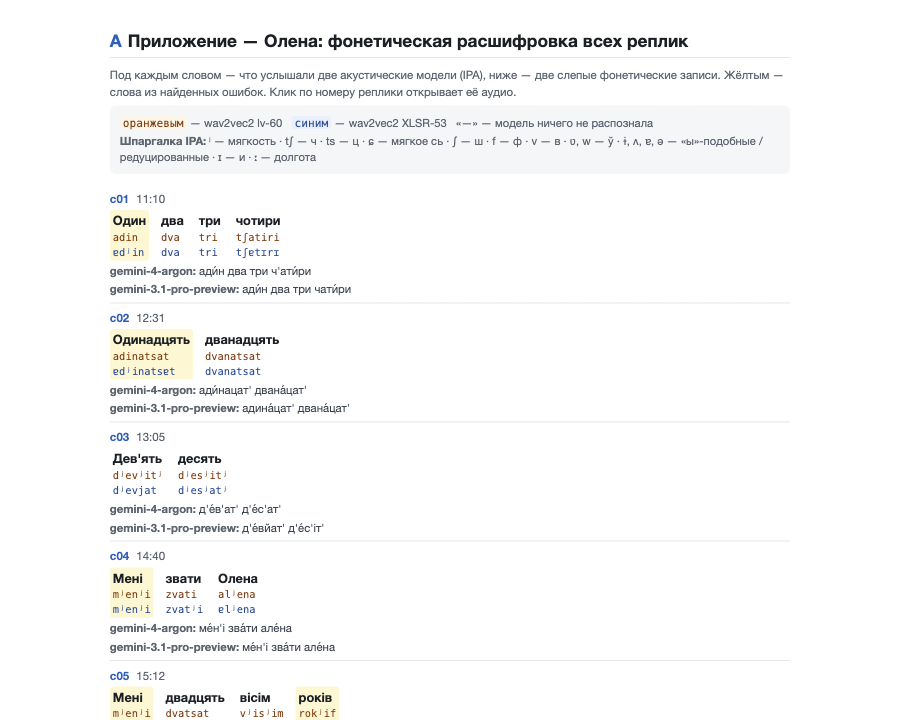

## How it works

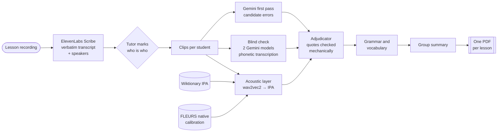

Each step writes its own result to the lesson folder. If the PC sleeps or the app restarts, processing resumes from
the first unfinished step, and finished (paid) steps are never repeated.

### When is a mistake "confirmed"?

A single listening model invents mistakes. Vymova therefore treats every first-pass finding as a hypothesis:

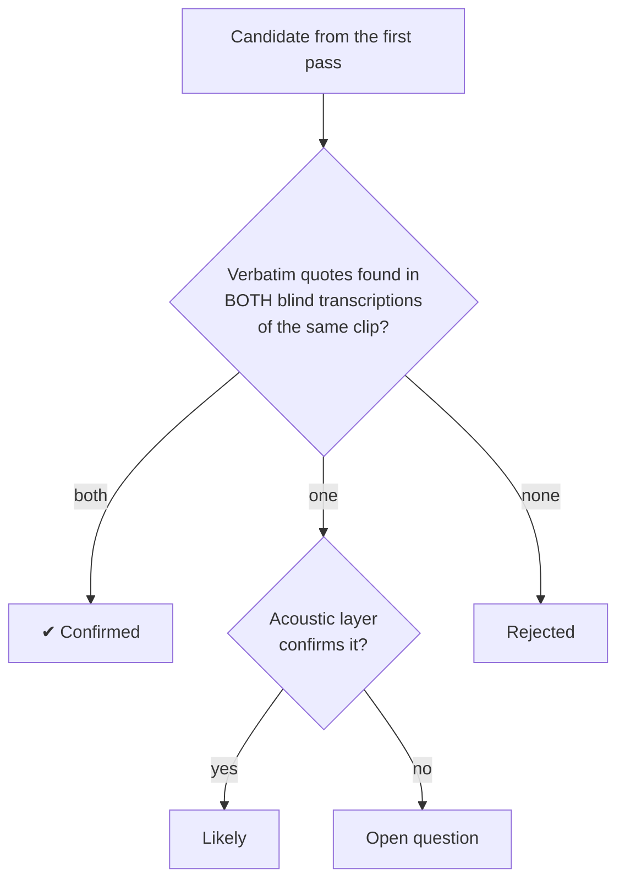

The blind models never see the candidates; they only write down what they hear. The adjudicator has to cite both
transcriptions word for word, and code checks that the quotes exist and match each other.

## Install (Windows)

1. Install **Docker Desktop**: https://www.docker.com/products/docker-desktop/
   - Keep "Use WSL 2" checked, then restart the PC.
   - You need 8 GB of RAM and about 10 GB of free disk space.
2. Open [Releases](https://github.com/leovvay/vymova/releases/latest) and download `vymova-start.bat`.
3. Double-click it.
   - The first run downloads the app (a few GB) and takes a while. After that it starts in seconds.
   - The browser opens when the app is ready.
4. Open «Настройки» (Settings) and paste the keys:
   - **ElevenLabs** — https://elevenlabs.io → Profile → API Keys (Speech to Text access is required).
   - **Gemini** — https://aistudio.google.com/apikey. Use a **paid** tier. On the free tier Google may use the data it
     receives, and here that data is your students' voices.

Lessons and PDFs are stored in `Documents\Vymova\lessons`. To update the app, run `vymova-start.bat` again. It never
interrupts a lesson that is being processed.

## Development

```
cd backend && uv venv && uv pip install -e ".[ml]"
DATA_DIR=/tmp/vymova-data MODELS_DIR=/tmp/vymova-models .venv/bin/vymova serve
cd frontend && npm ci && npm run dev          # proxies /api to 127.0.0.1:8766 (VYMOVA_API)
```

- Build the image: `docker build -f docker/Dockerfile -t vymova .`
- Release: push a `v*` tag. GitHub Actions builds `ghcr.io/leovvay/vymova` (linux/amd64) and attaches the launcher to
  the release.
- Rebuild the acoustic calibration: `tools/calibration/build_calibration.py`. It needs `GEMINI_API_KEY`, `DATA_DIR` and
  `MODELS_DIR`.

Design and plan: `docs/superpowers/specs/` and `docs/superpowers/plans/`.

## Attribution

- Acoustic calibration: **FLEURS** (Google, CC-BY-4.0), Ukrainian subset.
- Reference word pronunciation: **Wiktionary** (en.wiktionary.org, CC-BY-SA).
- Models: facebook/wav2vec2-lv-60-espeak-cv-ft and facebook/wav2vec2-xlsr-53-espeak-cv-ft (Apache-2.0),
  microsoft/wavlm-base-plus-sv.
